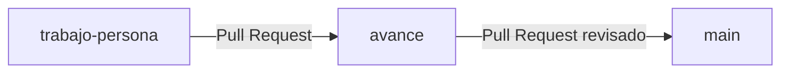

# Guía Git + GitHub desde VS Code en Ubuntu

Esta guía está pensada para comenzar sin GitHub Desktop.

## 1. Primera configuración

En VS Code, abre la terminal con `Ctrl+Alt+T` o `Terminal > Nueva terminal`.

```bash
cd /home/estudiante/Documentos/hackaton/hackathon-verificacion-humana
git config --global user.name "TU NOMBRE"
git config --global user.email "TU_CORREO_DE_GITHUB"
git fetch --prune origin
```

Nunca publiques contraseñas, tokens ni claves privadas.

## 2. Mantener una rama base

```bash
git switch avance
git pull --ff-only origin avance
```

Si aún no existe `main` localmente:

```bash
git switch --create main origin/main
```

## 3. Crear una rama personal

Una rama por persona o tarea:

```bash
git switch avance
git pull --ff-only origin avance
git switch --create trabajo-jose

git push -u origin trabajo-jose
```

Usa nombres como `trabajo-maria-frontend` o `tarea-api-jose`.

## 4. Guardar trabajo desde VS Code

1. Cambia a la rama personal.
2. Edita los archivos.
3. Abre el icono **Control de código fuente**.
4. Revisa los archivos modificados.
5. Pulsa `+` para preparar los cambios.
6. Escribe un mensaje breve, por ejemplo `feat: agrega endpoint de salud`.
7. Pulsa **Confirmar** y luego **Sincronizar cambios**.

En terminal, el equivalente es:

```bash
git status
git diff
git add archivo-modificado
git commit -m "feat: agrega endpoint de salud"
git push
```

## 5. Obtener trabajo actualizado

Antes de empezar cada día:

```bash
git fetch --prune origin
git switch avance
git pull --ff-only origin avance
git switch trabajo-jose
git rebase avance
```

Si aparece un conflicto:

1. VS Code mostrará los archivos en conflicto.
2. Selecciona la versión deseada con **Aceptar entrante/actual/ambas**.
3. Guarda el archivo.
4. Ejecuta:

```bash
git add archivo-resuelto
git rebase --continue
```

Para cancelar el rebase:

```bash
git rebase --abort
```

## 6. Crear un Pull Request

1. Publica la rama personal con `git push -u origin trabajo-jose`.
2. Abre el repositorio en GitHub desde el navegador.
3. Pulsa **Compare & pull request**.
4. Selecciona `base: avance` y `compare: trabajo-jose`.
5. Describe qué hiciste y cómo probarlo.
6. Solicita revisión a otra persona.
7. No combines a `main` hasta que el equipo haya probado la integración.

Más adelante:



## 7. Comandos esenciales

```bash
git status                 # qué cambió
git branch --show-current  # rama actual
git diff                   # revisión sin preparar
git log --oneline -10      # historial reciente
git restore archivo        # descartar cambios locales
git restore --staged archivo
git stash push -u -m "temporal"
git stash pop
```

## 8. Situaciones frecuentes

- **Cambios locales al cambiar de rama:** usa `git stash`, cambia de rama y luego `git stash pop`.
- **Rama desactualizada:** ejecuta `git fetch --prune origin` y haz rebase sobre `avance`.
- **Push rechazado:** no uses `git push --force`; primero ejecuta `git pull --rebase` o avisa al equipo.
- **Token solicitado en HTTPS:** usa el navegador o configura SSH; nunca uses la contraseña de GitHub como token.

## 9. Autenticación recomendada: SSH

```bash
ssh-keygen -t ed25519 -C "TU_CORREO_DE_GITHUB"
cat ~/.ssh/id_ed25519.pub
```

Copia la clave pública completa en GitHub: `Settings > SSH and GPG keys > New SSH key`.

Comprueba la conexión:

```bash
ssh -T git@github.com
```

Luego configura el remoto:

```bash
git remote set-url origin git@github.com:jachs-unc/hackathon-verificacion-humana.git
```
